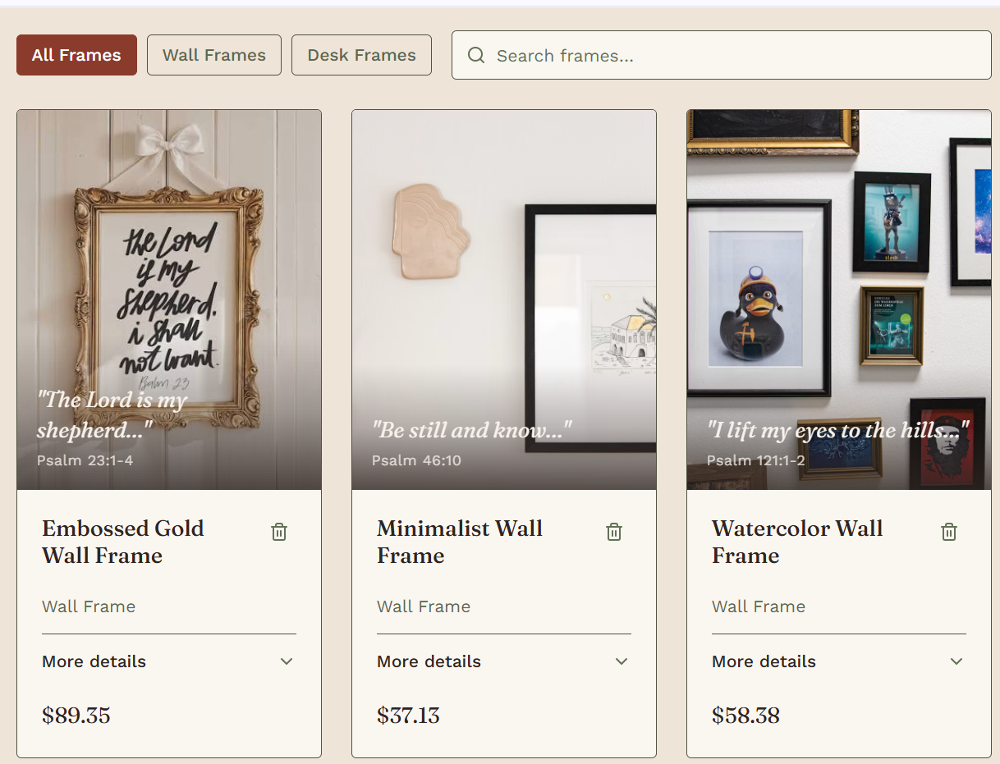
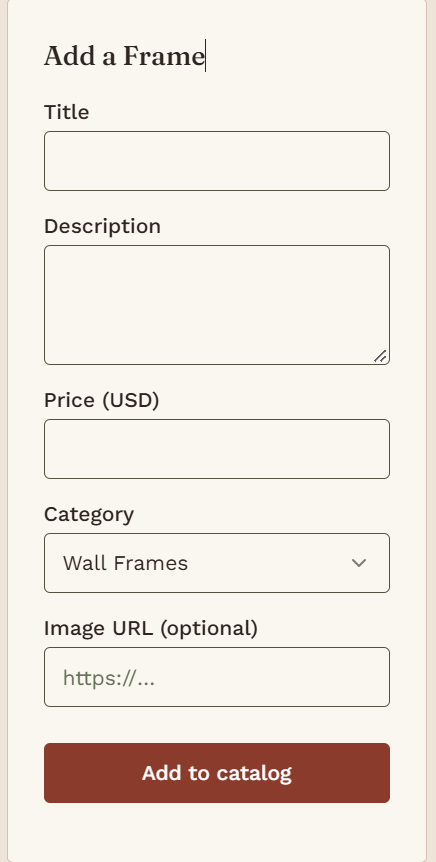
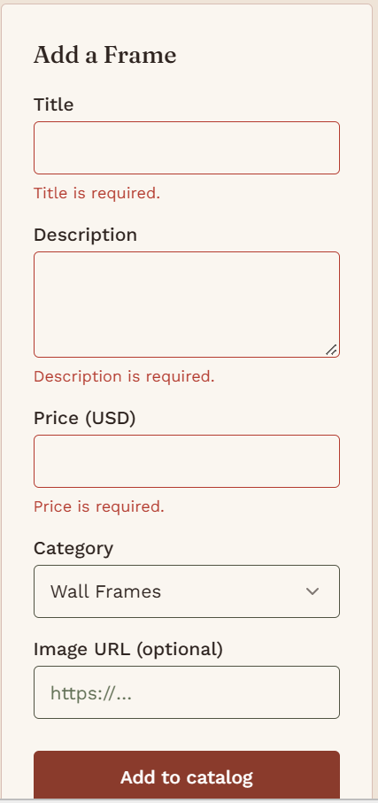
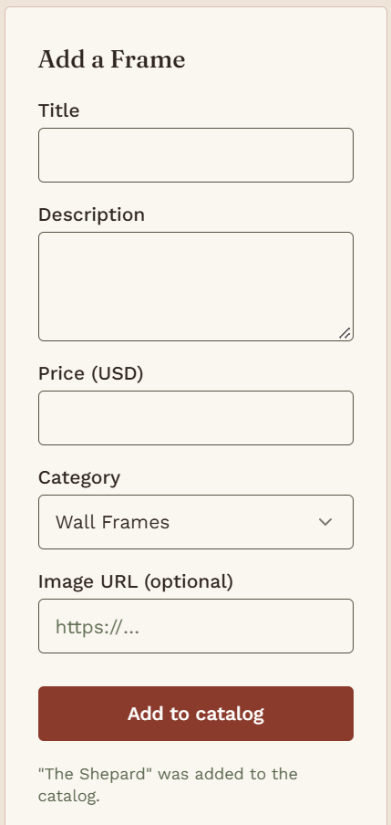
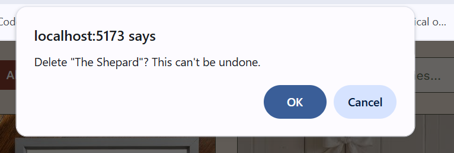
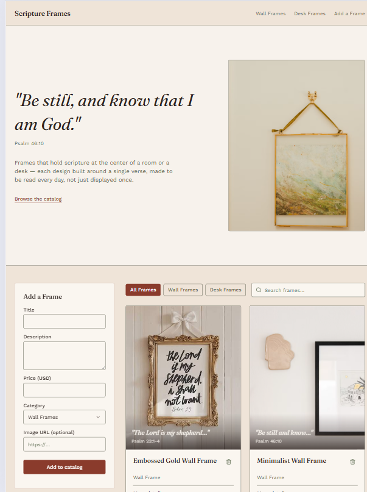
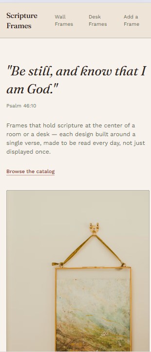
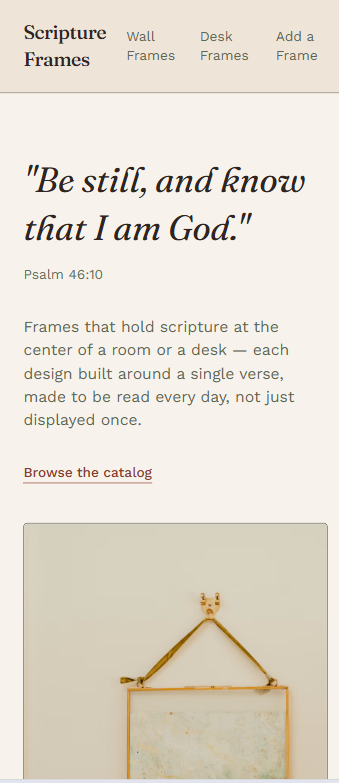

# Scripture Frames — Product Catalog SPA

A single-page React catalog for a fictional online shop selling
scripture-centered wall and desk frames. This was built as the Second
Semester Examination project for the Frontend Engineering Course offered
by AltSchool Africa. The project features a full product catalog with
add/delete, search, filtering, form validation, and an accessibility-focused
build.

## Table of Contents
- [Features](#features)
- [Screenshots](#screenshots)
- [Tech Stack & Architecture Decisions](#tech-stack--architecture-decisions)
- [Installation & Setup](#installation--setup)
- [Available Scripts](#available-scripts)
- [Project Structure](#project-structure)
- [API / Data](#api--data)
- [Deployment](#deployment)
- [Known Issues & Limitations](#known-issues--limitations)
- [Future Improvements](#future-improvements)

## Features

- **50 mock products:** split into two categories, twenty-five Wall Frames
  and twenty-five Desk Frames, each with a title, description, price, and
  image.
- **Add a Frame:** a form for adding new products, built with
  [React Hook Form](https://react-hook-form.com/). Title, description, and
  price are required, and price must be a positive number. The image URL
  field is optional, falls back to a placeholder image if left blank, and
  is validated to make sure it's a properly formed URL if provided.
- **Delete a product:** every card has a delete button with a confirmation
  prompt before it removes the item.
- **Search:** filters products live by title or description.
- **Category filter:** toggles between All, Wall Frames, and Desk Frames,
  and combines with search.
- **Conditional rendering** for every real-world state: a simulated loading
  skeleton on first load, an error state, and an empty state when a search
  or filter combination matches nothing.
- **Error Boundary:** separate error boundaries wrap both the form and the
  catalog grid, so bugs can be identified and fixed easily.
- **Fully responsive, mobile-first layout:** the sidebar form stacks above
  the catalog grid on small screens.
- **Accessibility built in:** semantic HTML hierarchy observed through
  `header`, `nav`, `main`, `aside`, `section`, and `footer` elements, a
  single `h1` with a clean heading hierarchy, a skip-to-content link,
  `aria-live` regions for search results and form feedback, visible focus
  states throughout, and `prefers-reduced-motion` support.
- **Photo captions with real scripture text:** rather than faking product
  photography that doesn't exist, each of the original 50 products overlays
  its actual verse and reference as a caption on the photo.

## Screenshots

**Catalog and core features**


*The product grid with category filter and search, desktop view.*


*The Add a Frame form, empty state.*


*Validation errors shown when required fields are left blank.*


*Confirmation shown after a product is successfully added.*


*The confirmation prompt shown before a product is deleted.*

📹 [Watch a short demo of the delete flow](./screenshots/delete-button-demo.mp4)

**Responsive layout across devices**


*iPad Pro 13" — sidebar form and catalog grid side by side.*


*iPhone 16 Pro Max — the layout stacks to a single column.*


*Samsung Galaxy A55 — nav and layout adapt further for a smaller screen.*

## Tech Stack & Architecture Decisions

**Core**
- React 19 (functional components + hooks) + Vite
- Tailwind CSS v4

**Forms**
- [React Hook Form](https://react-hook-form.com/) handles all form state,
  validation, and error messages for the Add a Frame form. The one field
  that needed special handling was the Category dropdown, since it's a
  custom Radix-based component rather than a plain `<select>`, so it's
  wired in with React Hook Form's `Controller`.

**UI components**
- ShadCN/UI-style primitives (Button, Input, Textarea, Label, Select, Card)

**Icons**
- [Lucide React](https://lucide.dev/): used for the search icon, the
  accordion chevron, the delete icon, and (inside the Select component)
  the dropdown chevrons and selected-item checkmark.

**Architecture**
- State is centralized in one custom hook, `useCatalog.js`, which owns the
  product list, loading/error state, search term, category filter, and the
  add/delete functions. `App.jsx` calls this hook once and distributes
  pieces of it down to child components as props. It holds no state or
  logic of its own, only layout.
- Components are split by responsibility: presentational components
  (`Header`, `Hero`, `ProductCard`) versus components that own real
  interaction logic (`ProductForm`, `CategoryFilter`, `SearchBar`).
- Data flows down through props, and actions (add, delete, search, filter)
  flow back up through callback props. This is the standard one-way React
  data flow.

## Installation & Setup

```bash
git clone <your-repo-url>
cd scripture-frames
npm install
npm run dev
```

Then open the local URL Vite prints in the terminal (usually
`http://localhost:5173`).

## Available Scripts

| Command | What it does |
|---|---|
| `npm run dev` | Starts the Vite development server with hot-reload |
| `npm run build` | Builds an optimized production bundle into `dist/` |
| `npm run preview` | Serves the production build locally, to sanity-check it before deploying |
| `npm run lint` | Runs [oxlint](https://oxc.rs/docs/guide/usage/linter.html) over the codebase |

## Project Structure

```
src/
  data/
    products.js        50 mock products (25 wall-frame, 25 desk-frame)
  hooks/
    useCatalog.js       all catalog state: loading, search, filter, add, delete
  lib/
    utils.js            cn() helper used by every ShadCN-style component
  components/
    ui/                 ShadCN-style primitives (button, input, select, card...)
    Header.jsx
    Hero.jsx
    ProductForm.jsx     add-product form (React Hook Form + validation)
    SearchBar.jsx
    CategoryFilter.jsx
    ProductGrid.jsx     loading / error / empty states + the grid itself
    ProductCard.jsx     individual card, including delete + accordion
    ErrorBoundary.jsx
  App.jsx               layout + wiring only, no state of its own
  index.css             Tailwind + design tokens (colors, fonts)
```

## API / Data

No external API is used. Per the assignment brief, product data is a
hardcoded/mocked array (`src/data/products.js`), standing in for what
would normally come from a backend. Product images are real,
freely-licensed photos pulled from [Unsplash](https://unsplash.com)
(hotlinked from `images.unsplash.com`), used as realistic stand-ins since
no genuine product photography exists for a niche product like this.

## Deployment

This is a static Vite app, so it deploys the same way on either Netlify or
Vercel:

- **Build command:** `npm run build`
- **Publish/output directory:** `dist`

**Netlify:** connect the GitHub repo, accept the detected build settings
(or set them manually as above), and deploy.

**Vercel:** import the GitHub repo. Vercel auto-detects Vite projects and
fills in the same build command and output directory automatically.

No environment variables are required, since there's no external API.

## Known Issues & Limitations

- **No persistence.** Refreshing the page resets the catalog back to the
  original 50 products, and anything added or deleted during a session is
  lost. There's no backend or `localStorage` layer yet (see Future
  Improvements below).
- **Product images are hotlinked**, not stored in this repository. The app
  needs an internet connection to display them, and depends on Unsplash
  staying reachable.
- **The add-product form keeps to five fields**: title, description,
  price, category, and image, matching exactly what the assignment brief
  asks for. Products added through it won't have a photo caption, since
  that requires the verse and scripture reference the original 50 products
  were seeded with, and the form doesn't collect those. `ProductCard`
  handles this gracefully, it just skips the caption when that data isn't
  there.
- **Delete uses a native `window.confirm()` dialog**, rather than a styled
  in-app confirmation modal, for simplicity.

## Future Improvements

- Persist catalog changes with `localStorage`, or a real backend.
- An **edit product** feature, alongside the existing add/delete.
- Sorting (by price, alphabetically) and pagination for the grid.
- Download the current Unsplash images into the repo itself
  (`public/images/`) so the catalog works fully offline.
- Replace `window.confirm()` with a proper accessible modal for delete
  confirmation.
